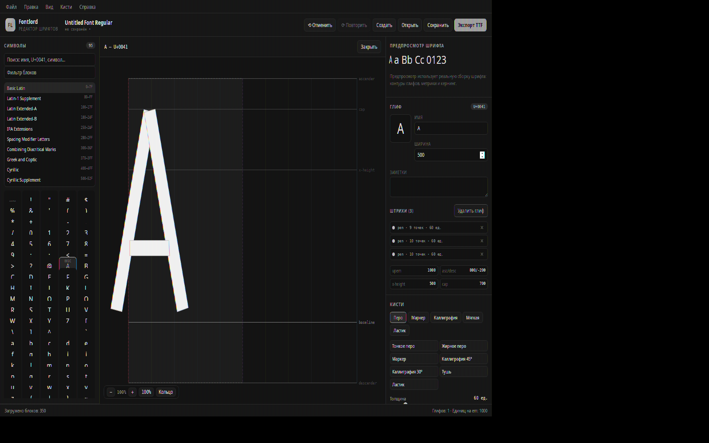

# Fontlord

Редактор шрифтов, в котором символ рисуется мышью как в растровой
программе, но специальные кисти превращают рисунок в настоящие векторные
контуры TrueType. Готовый шрифт экспортируется в `.ttf` и открывается в
любом редакторе шрифтов.



## Возможности

* **Сетка всех символов Unicode** — 350 блоков, группировка по блокам,
  категории Unicode, имена символов.
* **Поиск** по имени (`snowman`), по коду (`U+2603`, `0x2603`) и по самому
  символу.
* **Пять кистей**: перо (толщина по нажиму), маркер (постоянная толщина),
  каллиграфия (перо под углом), мягкая кисть и ластик.
* **Редактор глифа**: em-квадрат, направляющие (ascender, cap-height,
  x-height, базовая линия, descender), ширина продвижения, масштаб.
* **Промежуточные сохранения** в формате `.fontlord` (JSON с версией),
  атомарная запись, история изменений с отменой и повтором.
* **Экспорт TrueType**: таблицы `glyf`, `cmap`, `head`, `hhea`, `hmtx`,
  `maxp`, `name`, `OS/2`, `post`, `kern`.
* **Предпросмотр шрифта** прямо в интерфейсе — собирается настоящий TTF и
  отрисовывается через `FontFace`.
* **Задел под лигатуры и диакритику**: структуры данных и расчёты уже
  реализованы в ядре (см. [PLAN.md](PLAN.md), этап 8).
* **Меню верхнего уровня** (Файл, Правка, Вид, Кисти, Справка) с
  навигацией стрелками и подсказками горячих клавиш.
* **Горячие клавиши** на все основные действия.

### Горячие клавиши

| Клавиши | Действие |
|---------|----------|
| `Ctrl+N` | новый проект |
| `Ctrl+O` | открыть проект |
| `Ctrl+S` / `Ctrl+Shift+S` | сохранить / сохранить как |
| `Ctrl+E` | экспортировать TTF |
| `Ctrl+Z` / `Ctrl+Y` | отменить / повторить |
| `Ctrl+Q` | выход |
| `Ctrl+B` | показать или скрыть панель символов |
| `Ctrl+0`, `Ctrl++`, `Ctrl+−` | масштаб холста |
| `B`, `M`, `N`, `S`, `E` | перо, маркер, каллиграфия, мягкая кисть, ластик |
| `Del` | удалить глиф |
| `Esc` | закрыть глиф |
| `F1` | о программе |

## Устройство

```
crates/fontlord-core   доменное ядро: модель, кисти, контуры, Unicode, формат проекта
crates/fontlord-ttf    сборщик шрифтов TrueType
crates/fontlord-cli    консольные утилиты: info, glyphs, export, demo
src-tauri              IPC-слой Tauri и состояние приложения
ui                     интерфейс на React + TypeScript + Vite
tools                  скрипты окружения и вспомогательные утилиты
```

Подробное описание архитектуры и ход работ — в [PLAN.md](PLAN.md).

## Сборка

Зависимости: Rust 1.85+, Node.js 20+, pnpm, а также системные пакеты
`webkit2gtk-4.1`, `libgtk-3-dev`, `libsoup-3.0-dev` (для Linux).

### Linux без root-доступа

Скрипт `tools/fetch-sysdeps.sh` раскладывает системные зависимости в
локальный sysroot, `tools/env.sh` подключает его к сборке:

```bash
./tools/fetch-sysdeps.sh .local-sys
source tools/env.sh
```

### Общая сборка

```bash
source tools/env.sh
cd ui && pnpm install && pnpm build && cd ..
cargo build --release -p fontlord
```

Готовый исполняемый файл: `target/release/fontlord`.

То же самое через `make`:

```bash
make deps      # системные зависимости (один раз)
source tools/env.sh
make deps-ui
make build     # приложение и CLI
make bundle    # установочные пакеты
```

### Сборка под основные платформы

| Платформа | Пакеты |
|-----------|--------|
| Linux | `deb`, `rpm`, `AppImage` |
| macOS | `.app`, `.dmg` (x86_64 и Apple Silicon) |
| Windows | `MSI`, `NSIS` |

Иконки для всех платформ лежат в `src-tauri/icons` (`icon.ico`, `icon.icns`
и набор PNG). Перегенерировать их из исходного `icon.png`:

```bash
make icons
```

Непрерывная сборка описана в `.github/workflows`:

* `build.yml` — проверки (форматирование, clippy, тесты) и сборка на
  Linux, macOS и Windows;
* `release.yml` — сборка установочных пакетов и публикация релиза по тегу
  `v*`.

### Запуск в режиме разработки

```bash
source tools/env.sh
cd ui && pnpm dev        # Vite на http://localhost:1420
cd .. && cargo tauri dev
```

## Проверка качества

```bash
source tools/env.sh
cargo test --workspace
cargo clippy --workspace --all-targets -- -D warnings
cargo fmt --all -- --check
```

Консольные утилиты позволяют работать с проектами без графического
приложения:

```bash
cargo run -p fontlord-cli -- demo /tmp/demo.fontlord      # демо-проект
cargo run -p fontlord-cli -- info /tmp/demo.fontlord       # сводка
cargo run -p fontlord-cli -- glyphs /tmp/demo.fontlord     # список глифов
cargo run -p fontlord-cli -- export /tmp/demo.fontlord /tmp/demo.ttf
```

Демонстрационный шрифт собирается и растеризуется командами:

```bash
cargo run -p fontlord-ttf --example export_sample -- demo.ttf
cargo run -p fontlord-ttf --example render_glyphs -- demo.ttf glyphs.ppm
```

## Лицензия

MIT или Apache-2.0.
